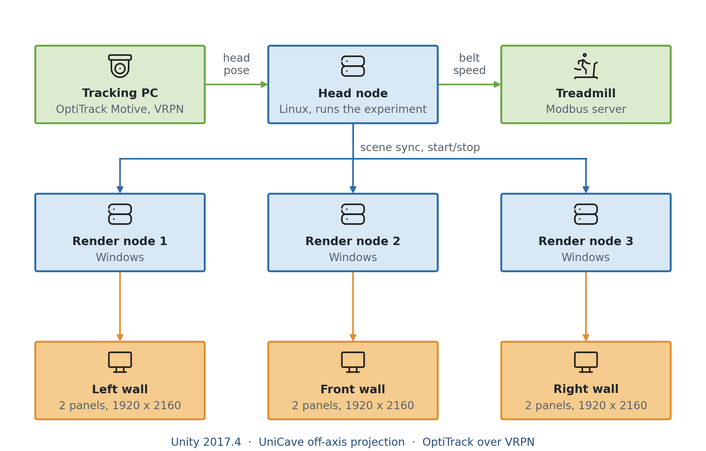
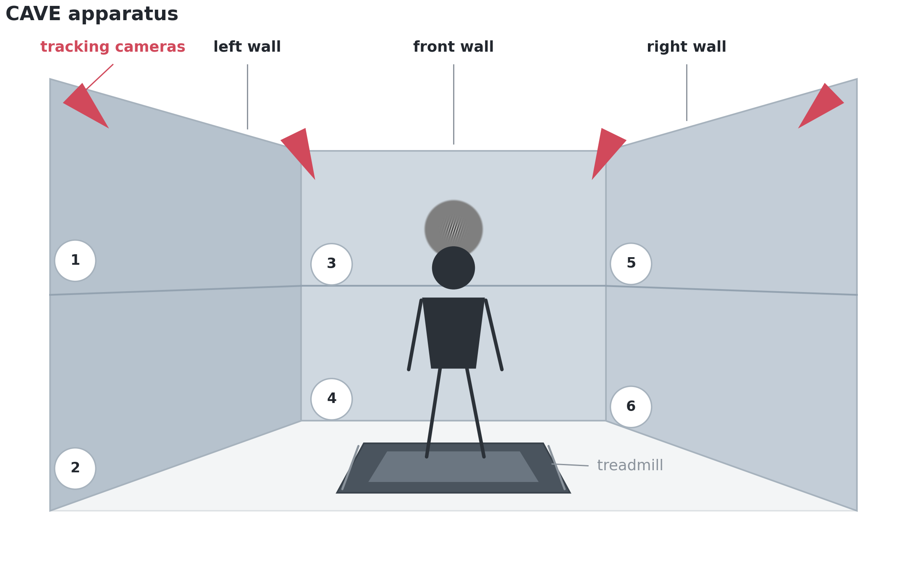
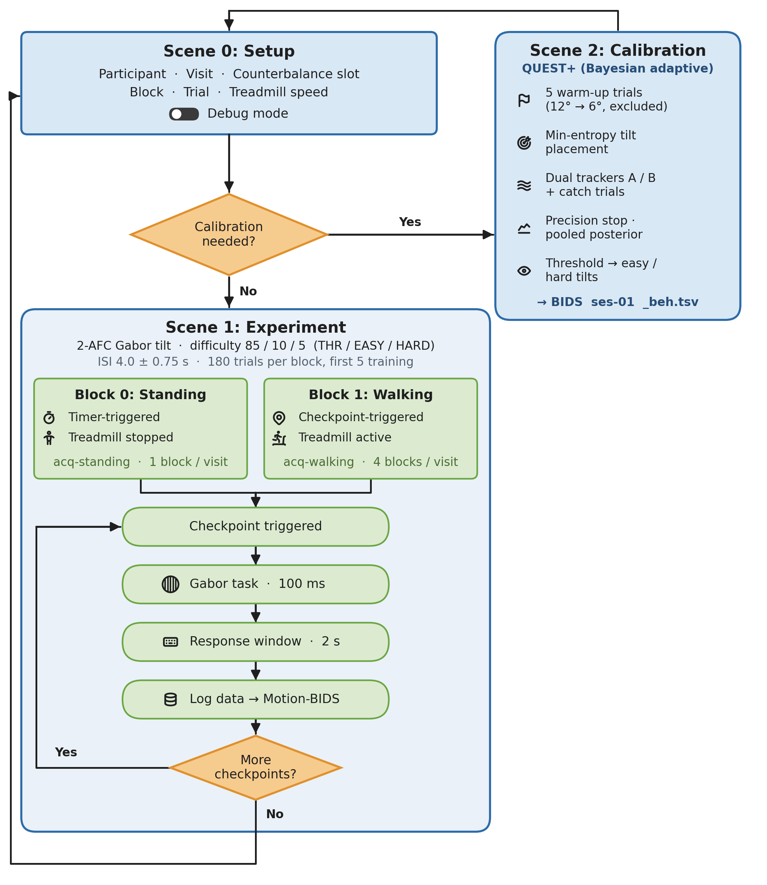
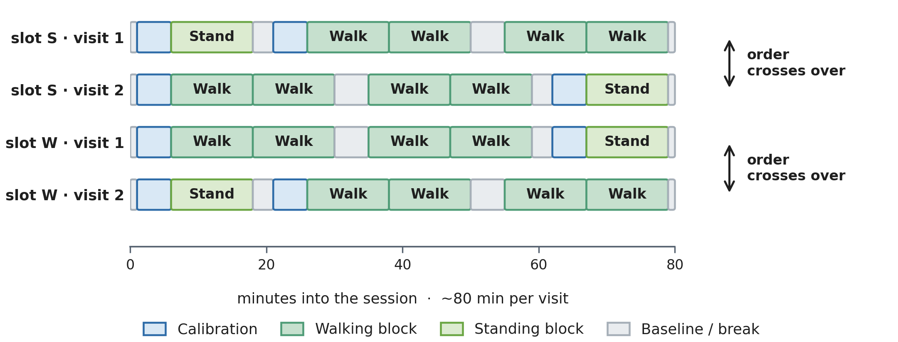
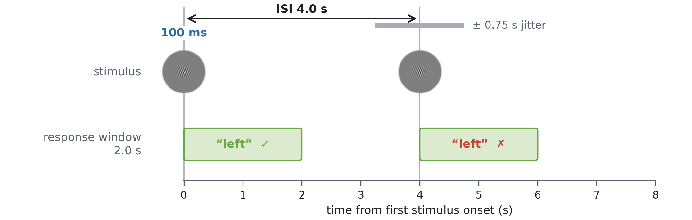
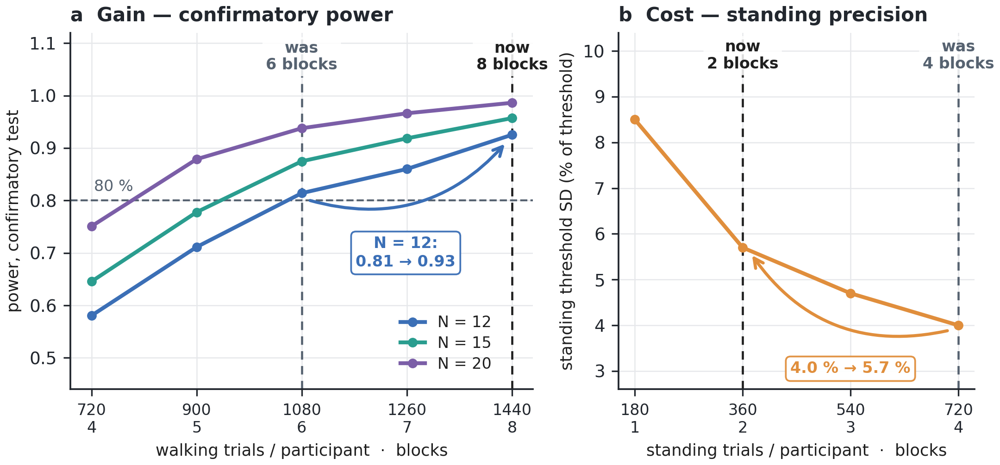

<h1 align="center">PACE: Perception Across Cyclic Events</h1>

<p align="center"><em>Does the <b>phase of the stride cycle</b> modulate visual perception during walking?</em><br>
Master's thesis project · Bielefeld University</p>

<p align="center">
  
  
  
  
  <a href="https://doi.org/10.1038/s41467-024-45780-4"></a>
</p>

PACE is a virtual-reality experiment for a **CAVE** with a treadmill, plus the Python pipeline
that analyses it. Participants stand still or walk in place on the treadmill along a virtual
path while brief **Gabor patches** test **two-alternative tilt discrimination**. A **QUEST+**
calibration runs **per condition**, so each block sits at that condition's own threshold. The
question is whether accuracy and response time oscillate with the **phase of the stride**,
as **Davidson, Verstraten & Alais (2024)** found for contrast detection
([*Nat. Commun.* 15:2027](https://doi.org/10.1038/s41467-024-45780-4)); PACE tests it for tilt
discrimination.

<p align="center"></p>

> **What this repository contains, and what it does not.**
> - ✅ The complete **Unity project** (scenes, scripts, plugins, the assets the scenes use),
>   the **rig scripts** to build, deploy and start it, and the full **analysis pipeline** with
>   its test suite, power analysis and methods figures.
> - ❌ **No participant data.** The pipeline runs end to end on synthetic participants
>   (`python -m Analysis.simulate_participants`); real data are not published here.
> - ❌ **No compiled builds**, and no machine names, addresses, user names or keys of the
>   original installation. The Unity scenes carry **placeholders** (`HEAD-NODE`,
>   `RENDER-NODE-1…3`, `tracking-pc`, `127.0.0.1`), and the rig scripts read every host and
>   path from a git-ignored `rig/rig.env`.
> - ❌ The lab's **native hardware servers** (treadmill and motion-base bridges) and the render
>   nodes' **start/stop listener**, which belong to the installation.
>
> **So the experiment does not run out of the box.** It needs a CAVE with UniCave-style render
> nodes, OptiTrack tracking and a treadmill bridge, and the placeholders set for that rig
> ([INSTRUCTIONS.md §12](INSTRUCTIONS.md#12-one-time-rig-setup)). The **analysis pipeline**
> runs anywhere with Python.

**Where to go:** ▶️ run a session → [INSTRUCTIONS.md](INSTRUCTIONS.md) · 📊 analysis pipeline →
[Analysis/README.md](Analysis/README.md) · 📈 power analysis →
[Analysis/davidson_power/README.md](Analysis/davidson_power/README.md)

### At a glance

| | |
|---|---|
| **Task** | 2-AFC Gabor tilt (left/right), 100 ms, near threshold |
| **Conditions** | standing vs walking (walk-in-place on the treadmill, 1.0 m/s) |
| **Calibration** | per-condition QUEST+ (threshold only; β 2.5, λ 0.05 fixed) |
| **Difficulty mix** | 0.85 / 0.10 / 0.05 at the 75 / 85 / 65 % points; ISI 4 s ± 0.75 s, response window 2 s |
| **Collection design** | 2 visits × (4 walking + 1 standing block) = **8 walking + 2 standing** blocks per participant (**~1440 walking trials**); N 12–20 analysable, enrol 15–16 |
| **Rig** | Linux head node + 3 Windows render nodes; 6 half-walls (65″ 4K panels); OptiTrack over VRPN; Modbus treadmill on a level, unused 6-DOF motion base |
| **Data / analysis** | Motion-BIDS → gait / stride phase → **confirmatory phase-agnostic population test** (2 & 4 cycles per stride, Holm); common-phase, Bayesian mixed-model and prevalence routes as secondary |

---

## Contents

1. [Hardware](#1-hardware)
2. [Software stack](#2-software-stack)
3. [Repository layout](#3-repository-layout)
4. [The paradigm](#4-the-paradigm)
5. [Build, deploy and run](#5-build-deploy-and-run)
6. [Data output](#6-data-output)
7. [Design and power](#7-design-and-power)
8. [Analysis pipeline](#8-analysis-pipeline)
9. [Troubleshooting](#9-troubleshooting)
10. [Planned extensions](#10-planned-extensions)
11. [References](#11-references)
12. [Licence and citation](#12-licence-and-citation)
13. [AI usage declaration](#13-ai-usage-declaration)

> This README is the *what and why*. **[INSTRUCTIONS.md](INSTRUCTIONS.md)** is the *how to
> operate*: what to type on the setup screen for every block, both counterbalance arms, and
> how to convert and check the output.

---

## 1. Hardware

The experiment was built for the **Interactive Locomotion Lab** at Bielefeld University, a
CAVE documented in full in [Hofmann (2023)](#11-references), ch. 2, which is the source for
the model numbers and tolerances below. Machines are named here by role.

### Machines

| Machine | Role |
|---|---|
| **Head node** (Linux) | Runs the Unity Linux build: owns head tracking, hosts the networking server, commands the render nodes, talks to the treadmill. Shows the operator overlay. |
| **Render nodes 1–3** (Windows) | Each drives one screen *column* (two stacked panels exposed as one 1920 × 2160 window) with the Unity Windows build. |
| **Tracking PC** | Runs OptiTrack **Motive**; streams the head pose to the head node over VRPN. |
| **Treadmill PC** | Runs the Modbus server in front of the belt hardware. |
| **Motion-base controller** | Industrial PC needing a pose every 0.5 ms (2 kHz) or it e-stops; a bridge resamples Unity's 50–60 Hz stream. *Not used by PACE.* |

### Physical installation

<p align="center"></p>
<p align="center"><sub>The participant on the treadmill, facing the front wall, with the Gabor target at eye height. Each wall is two stacked panels (1–6); red wedges are tracking cameras.</sub></p>

| Device | Specification |
|---|---|
| **Treadmill** | 2.5 × 1.5 m, Ingenieurbüro Achilles. Belt capped by the installation at 4 m/s; `TreadmillController` clamps to 5 m/s before sending, so the installation cap binds. Speed goes over UDP (`S<km/h>` to port 1338) to the Modbus bridge. |
| **Motion base** | Moog 170-140B-2-D-1 Stewart platform, 6 DOF, 1000 kg rated load, carrying the treadmill; software-limited to ±10°, 5 °/s, 15 °/s². **PACE holds it level and still**; `MotionBaseController.cs` is retained from earlier work and unused. |
| **Display** | Six 65″ Sony Bravia X85 panels, 3840 × 2160 @ 60 Hz, active area 142 × 80 cm each, in three columns × two rows on a half hexagon (side columns rotated 60°). Upper panels are mounted upside down to shrink the inter-row gap to 2 cm; the bottom rim sits 0.5 m above the belt. From 170 cm eye height the array subtends ≈ 180° × 64°. Default projection is **OffAxis** (a true window), with render-eye sway damping (§5). |
| **OptiTrack** | 16 Flex 13 cameras at 120 fps, ~0.2 mm accuracy after calibration; Motive → VRPN → the `unityVrpn` plugin (`VRPN.cs`). Calibrate in Motive (warm-up, wand to sub-mm, asymmetric head rigid body, Streaming ID 1). |
| **Response device** | Left/Right buttons for the response; Space/PageDown to start. |
| **Safety** | Independent, electrically isolated e-stop circuit; mechanical brakes halt belt and platform in < 10 ms. Full-body harness on a retracting lifeline. |

**Latency** (Hofmann 2023, App. C; not re-measured here): tracking → render → panel 127 ms in
total, of which the panels alone cost ≈ 40 ms. Stimuli are logged on the frame they are
*rendered*, so photons land ≈ 40 ms later. That constant offset leaves the modulation
**amplitude** untouched and shifts the **preferred phase** by ≈ 26° at 2 cycles per stride.

PACE tracks the head rigid body only and reconstructs gait from head motion (§8).

---

## 2. Software stack

- **Unity 2017.4.25f1** (legacy `Network` / `NetworkView` multiplayer API).
- **UniCave** (Living Environments Laboratory) — off-axis projection and multi-node sync,
  under `Assets/UniCave/`.
- **VRPN** native plugin (`unityVrpn.dll` / `.so`) for OptiTrack tracking, plus the OptiTrack
  Unity plugin (NatNet) for the full 6-DOF head pose.
- **`rig/ill.py`** — signs (Ed25519) and sends `start` / `stop` commands to the render nodes'
  listener. The signing seed is a secret and never stored in the repository (§5).
- **Analysis:** Python 3.12, NumPy / SciPy / pandas / statsmodels, NumPyro for the Bayesian
  models (`Analysis/requirements.txt`).

---

## 3. Repository layout

```
PACE/
├── Assets/
│   ├── 00_SetupScene.unity        operator setup screen
│   ├── 01_MainExperiment.unity    experiment blocks
│   ├── 02_Calibration.unity       QUEST+ calibration
│   ├── ILL-UniCave 1 1.prefab     the CAVE rig: displays, cameras, tracking, networking
│   ├── Scripts/
│   │   ├── ExperimentConductor.cs Setup UI; participant / visit / block / trial; thresholds
│   │   ├── StaircaseManager.cs    QUEST+ calibration (§4)
│   │   ├── CheckpointManager.cs   experiment blocks: checkpoints, difficulty mix, logging
│   │   ├── FollowerPlane.cs       draws the Gabor (ShowTask(dir, angle))
│   │   ├── ILLLoggerController.cs per-frame CSV logging (§6)
│   │   ├── TreadmillController.cs treadmill speed client
│   │   ├── InputHandler.cs        start / left / right input
│   │   └── Splines/ ...           Bezier path generation
│   ├── UniCave/                   projection (ProjectionPlane.cs), sync (NetworkingSync.cs),
│   │                              tracking (VRPN.cs, VRPNTrack.cs), MasterTrackingData.cs
│   └── OptiTrack/                 OptiTrack Unity plugin (NatNet)
├── rig/                           build, deploy and start scripts (§5)
│   ├── rig.env.example            settings template → copy to rig.env (git-ignored)
│   ├── build.sh  dist.sh  start.sh  gather_logs.sh   head-node side (bash)
│   ├── deploy.ps1  start.ps1      workstation side (PowerShell)
│   └── ill.py                     signed start / stop for the render nodes
├── Analysis/                      Python pipeline, tests, power analysis, figures
├── data/                          BIDS dataset root (only the metadata skeleton is tracked)
├── gabor/                         stimulus previews (Analysis/gabor_preview.py)
├── INSTRUCTIONS.md                operator guide
└── README.md
```

### Scenes and flow

<p align="center"></p>
<p align="center"><sub>One session through the three Unity scenes, and the trial loop inside an experiment block.</sub></p>

1. **00_SetupScene** — the operator enters participant, visit, block, trial and speed, then
   starts *Calibrate Standing* / *Calibrate Walking* (→ scene 2) or *Start Experiment*
   (→ scene 1). A schedule text lists every step of the visit with the values to type.
2. **02_Calibration** — QUEST+ threshold estimation for the selected condition. Standing =
   treadmill off; walking = walk-in-place at block speed. The result is stored in that
   condition's slot and the scene returns to setup.
3. **01_MainExperiment** — `CheckpointManager` loads the block's condition thresholds and
   runs the task at three difficulty levels.

`block == 0` is **standing** (timed, belt stopped); `block > 0` is **walking** (belt plus spline
movement, checkpoint-triggered stimuli). Each condition is calibrated and run before the
other. The starting condition comes from a pre-generated **permuted-block allocation**
(`ExperimentConductor.ALLOCATION`) and **crosses over between a participant's two visits**.
Permuted blocks keep the standing-first / walking-first split within 2 at any point of
enrolment without being predictable; the crossover puts each condition once in the early and
once in the late half of a session, so the threshold contrast is purged of time-on-task
(`threshold_by_condition._crossover_model`).

<p align="center"></p>
<p align="center"><sub>Both allocation arms over two visits, to scale in minutes. Each condition is calibrated once per visit and run out; the leading condition swaps between visits.</sub></p>

The **block field selects the condition**; the **trial field is the run index**, which the BIDS
converter turns into a `run-` entity, so no block overwrites another.

---

## 4. The paradigm

### Task

2-AFC **orientation discrimination**: a Gabor tilted **left** or **right** (Left = `0`,
Right = `1`), shown for **100 ms** (`taskDuration`). The grating is a Gaussian-windowed Gabor of
**3 cpd, σ = 0.70°** (Davidson's values; `FollowerPlane` + `GaborShader`). The visible patch is
cut to ≈ 8.7° (`gaborDiskRadius` = 0.22 on the 0.7 m quad) so it reads as a small patch; the
spatial frequency and envelope are unchanged. `python Analysis/gabor_preview.py` renders it at
true visual angle (previews in `gabor/`).

<p align="center"></p>
<p align="center"><sub>Two consecutive trials to scale: a 100 ms Gabor, a 2 s response window, and a 4 s ± 0.75 s onset-to-onset ISI. The tilt is exaggerated for visibility; the second response is an error.</sub></p>

### Calibration — QUEST+ (`StaircaseManager.cs`)

QUEST+ (Watson 2017) estimates the **threshold** only, placing each trial at the tilt that
minimises the expected posterior entropy.

**Psychometric model** (Weibull on log₁₀ degrees):
`P(correct | x) = γ + (1 − γ − λ)·(1 − exp(−10^(β·(x − α))))`, with `x = log10(tilt)` and
`α = log10(threshold)`.

| Parameter | Value | Basis |
|---|---|---|
| γ (guess) | 0.5 | 2-AFC |
| λ (lapse) | 0.05 | Orientation lapses are 0.01–0.03 (Wichmann & Hill 2001); a lower value lets QUEST+ run away on a single suprathreshold lapse. |
| β (slope) | 2.5 | Discrimination Weibull slopes ≈ 1.4–3 (Wallis et al. 2013; May & Solomon 2013); underestimating the slope is the safer error (Serrano-Pedraza et al. 2020). |
| threshold grid | 0.3–25° | |

**Slope and lapse are fixed, not estimated live.** A short calibration estimates threshold
robustly but not slope (Paire et al. 2022). Slope and lapse are instead **checked offline**:
`Analysis/calibration_refit.py` fits threshold, slope and lapse by maximum likelihood on the
pooled calibration trials, and `Analysis/threshold_by_condition.py` tests whether the slope
differs between standing and walking (likelihood-ratio test) rather than assuming it does not.

**Procedure.** Two interleaved trackers (prior centres 4° and 2.5°, prior SD 0.5 log₁₀) in
shuffled order. The **final estimate is the pooled posterior** over both trackers' trials.
Calibration stops once the pooled posterior SD ≤ 0.10 log₁₀ (≥ 30 scored trials, ≤ 100 in
total), with an early abort at 80 trials if the SD is still > 0.18. Tracker agreement is
logged as a robustness flag. These rules were set and validated by simulation
(`Analysis/calibration_convergence_sim.py`).

**Warm-up and catch trials.** Each calibration opens with 5 warm-up trials on a descending
ramp (12° → 6°), and every 6th scored trial is followed by an unmistakable 12° catch trial;
neither feeds QUEST+. A run is flagged inattentive with ≥ 2 catch errors at a rate > 0.10.

**Reliability.** The operator overlay shows `DONE` or `UNRELIABLE` (operator only, never the
participant). *Reliable* means converged, attentive on the catch trials, and not railed (pooled
threshold < 12.5°). The analysis applies further checks of its own (`Analysis/calibration.py`).

**Per condition.** Locomotion shifts the threshold, not the slope (Davidson: threshold
*p* < 0.001, slope *p* = 0.063), so β is shared but each condition is calibrated separately.

### Difficulty levels

The three tilts are **target accuracies on the fitted psychometric function**, inverted to
angles: **hard = 65 %**, **threshold = 75 %** (near the steepest point, where a perturbation
moves accuracy most), **easy = 85 %**, via `x = α + log₁₀(−ln(1 − q))/β` with
`q = (P − γ)/(1 − γ − λ)` (`AngleForPercentCorrect`). `CheckpointManager` draws them at
**0.85 / 0.10 / 0.05** (threshold / easy / hard), the weighting chosen in the power analysis.

Tilt direction is balanced 50/50 with at most 2 identical directions in a row. Stimuli sit on
a path grid every `targetISI × speed` metres (walking) or every `targetISI` seconds
(standing): mean ISI **4 s**, jittered by **± 0.75 s**, so onsets are 3.25–4.75 s apart and
clear of the 2 s response window.

**In walking the jitter accumulates.** Onset time is a bounded random walk (reflected at ±3 s)
rather than a fixed grid plus independent jitter. On a fixed grid, a stride period that divides
the ISI — 1.0 s, an ordinary 120 steps/min — puts every onset at nearly the same stride phase,
and the ±0.75 s jitter alone does not spread it uniformly (Rayleigh R ≈ 0.2). Accumulating the
jitter decorrelates onset time from any stride period (R ≈ 0.07 from 75 to 133 steps/min).
Coverage is checked per recording (`onset_phase_coverage`).

### Run structure

Each block opens with a 30 s still-standing baseline and closes with a matched 30 s cool-down;
a head-height message (`HeadMessageDisplay`) marks the boundaries, and walking blocks warn
before the belt stops. The setup scene activates every connected display
(`SetupDisplayActivator`).

### Manual threshold override

A valid number in the setup screen's **Threshold** field is used directly as the 75 %
threshold and skips calibration (to resume after a crash). Easy and hard derive from it via
`easyFactor` = 1.26 and `hardFactor` = 0.76, the model-implied 85 % / 65 % ratios for γ = 0.5,
β = 2.5, λ = 0.02; keep them in step with `StaircaseManager` if the model changes.

### Key tunable fields

`StaircaseManager`: `guessRate, lapseRate (0.05), slopeBeta (2.5), minAngle, maxAngle,
startAngleA/B, priorLogSD (0.5), maxTotalTrials (100), targetHardPC/ThresholdPC/EasyPC
(0.65/0.75/0.85), taskDuration (0.1), interTrialDelay (4), isiJitter (0.75),
responseWindow (2)`.
`CheckpointManager`: `targetISI, isiJitter, trainingCheckpoints, thresholdWeight / easyWeight /
hardWeight (0.85/0.10/0.05), maxSameTiltRun (2), mapSeed, responseWindow, taskDuration (0.1)`.
The checkpoint count follows from path length, `targetISI` and speed.

---

## 5. Build, deploy and run

All rig scripts live in `rig/` and read the installation's machine names and paths from
**`rig/rig.env`**, a git-ignored copy of [`rig/rig.env.example`](rig/rig.env.example). Before
the first build, set the Unity placeholders for your rig
([INSTRUCTIONS.md §12](INSTRUCTIONS.md#12-one-time-rig-setup)).

```bash
# on the head node, in the project checkout
rig/build.sh               # headless build → Builds/Linux Main/   (render nodes: rig/build.sh windows)
rig/ill.py stop            # stop the render-node players (their files are locked while running)
rig/dist.sh                # wipe and refill the build folder on every render node, then verify
/path/to/runTreadmillServer   # the lab's Modbus bridge (not included), UDP port 1338
rig/start.sh               # start the render nodes, then the head-node build (graphical session)
```

From a Windows workstation, `rig\deploy.ps1` copies both builds to the head node and runs
`dist.sh`; `rig\start.ps1` starts a session on the head node's display. `rig/gather_logs.sh`
collects the render nodes' Unity logs into `RenderLogs/`.

`dist.sh` always **wipes before copying**: a render node running a mix of two builds shows
flicker and split scenes.

**Signed start/stop.** The render nodes run a listener (part of the installation) that
launches or kills the player on an Ed25519-signed msgpack command. `rig/ill.py` signs with a
seed read from `$ILL_SIGNING_KEY` or the file named by `ILL_SIGNING_KEY_FILE` (64 hex
characters, `chmod 600`).

### Operator controls

Space / PageDown start a block; Left / Right are the responses. Projection keys (broadcast from
the head node to all nodes; for comparison only, never during a session):

| Key | Action |
|-----|--------|
| `[` / `]` | Decrease / increase `parallaxScale` (stereo IPD), 0–2. |
| `F1` | **OffAxis** (default) — physically correct CAVE window, continuous corners, exact Gabor size. |
| `F2` | **Hybrid** — symmetric per-wall frustum, field of view frozen at a reference distance `dRef`; no wobble, but corner gaps and a resized Gabor. |
| `F3` | **HybridWide** — Hybrid with the field of view widened (×1.10) to close the corner gap. |
| `F4`–`F6` | **Partial** — off-axis with the shear scaled 0.3 / 0.5 / 0.7. |
| `F7` | **HybridSeamless** — Hybrid with the shared edges stretched to meet at the corner. |
| `P` | Toggle OffAxis ↔ Hybrid. |
| `=` / `-` | Tune the active mode. |
| `,` / `.` | (OffAxis) lower / raise the sway-smoothing cutoff `swaySmoothingHz`. |
| `R` | Recapture `dRef` from the current head pose. |

The mode starts in OffAxis on every launch and is shown on the operator HUD.

<details>
<summary><b>How the projection models work</b></summary>

Every model splits rendering into a **view matrix** (where the camera is) and a **projection
matrix** (the lens). **OffAxis** rebuilds an asymmetric frustum every frame from the live eye
position relative to the wall's corners, so each wall is an exact window onto the world — but
the shear amplifies tracking jitter into whole-scene wobble. The **Hybrid** family uses a
symmetric frustum sized once from a reference distance `dRef`, which gives correct motion
parallax without the field of view breathing, but adjacent walls then disagree at the corner
unless corrected (HybridWide overlaps them; HybridSeamless stretches the edges). OffAxis is the
default because it alone keeps the window continuous **and** the Gabor at its calibrated size.
`dRef` is captured per wall on the first valid frame and recaptured during each block's
standing baseline. Moving the whole rig along the path does not disturb any model, because
each recomputes the head pose relative to the walls in world space every frame. Each wall is
split top / bottom (two cameras), with the shared edge at the eye-level horizon.

**Render-eye sway damping (OffAxis).** OffAxis renders every head sway, so gait-induced lateral
sway makes the background slosh. The render eye therefore follows a low-passed copy of the
head's in-CAVE position (`swaySmoothingHz` = 1.8 Hz, one-pole, τ ≈ 88 ms) plus `swayGain` (= 0)
of the fast residual. World locomotion is untouched and the **logged head data are never
modified**, so the gait analysis stays raw. The settings are constant across conditions and
participants; the trade — head-coupled motion parallax for a stable viewpoint — is a documented
limitation of the rendering, not a perceptual manipulation.

</details>

---

## 6. Data output

**Experiment blocks** (`ILLLoggerController`). One semicolon-separated CSV per block, one row
**per rendered frame**, named `pXX-vV-bY-tZZ_walking.csv.gz` / `…_standing.csv.gz` (V = visit,
Y = block field, ZZ = trial field), written as a plain temp file during the run and gzipped at
the end. Per frame: timestamp and a monotonic high-resolution clock, head position and rotation
(global and in-CAVE), the full 6-DOF OptiTrack head pose (`head-mocap-*`), stimulus and
response onset pulses on the rendered frame, treadmill speed, path distance, mocap frame
counters, a lateral-sway alarm, and participant / visit / block / trial / counterbalance
slot. Trial columns are filled only on the frame that resolves a trial: filter on
`checkpoint-index != -1` for one row per trial (`difficulty-level`, `visual-tilt/angle`,
`checkpoint-response` (−1 = none), `response-correct` (1 / 0 / −1 = timeout),
`reaction-time-precise`, and the three threshold angles).

**Calibrations.** A per-trial CSV next to the block logs, suffixed
`_calibration_standing` / `_calibration_walking`: tracker (`A` / `B` / `catch` / `warmup`),
trial counters, presented tilt, direction, response, correctness, posterior mean and SD,
identity columns on every row, and `#` header lines with the final tilts, QUEST+ parameters
and the convergence and attention verdicts.

```bash
python Analysis/plot_calibration.py                                   # newest *_calibration*.csv here
python Analysis/plot_calibration.py p05-v1-b1-t01_calibration_walking.csv --no-show
```

A missed response (2 s window) is logged as a timeout and, in calibration, never fed to QUEST+.

---

## 7. Design and power

The effect size is **measured, not assumed**: it comes from Davidson et al.'s (2024) raw data
(OSF `8djtq`), refitted and checked against the authors' stored outputs, and the power figures
come from simulating this pipeline's own tests at that effect. Code and write-up:
[`Analysis/davidson_power/`](Analysis/davidson_power/README.md).

### The number that shapes the analysis: R = 0.33

Davidson's participants oscillate at **idiosyncratic preferred phases**; their cross-participant
phase coherence is only R = 0.33. Averaging coefficients that point in different directions
cancels most of the signal, which decides the population test:

| Population test | Asks | Power at N = 12 |
|---|---|---|
| **phase-agnostic** `Σᵢ |zᵢ|²/sᵢ²` | does each individual oscillate, at their own phase? | **0.92** ← confirmatory |
| common-phase Hotelling T² | does the population oscillate at one shared phase? | 0.15 |
| Bayesian prevalence | how many individuals pass a per-participant test? | ~0.15 |

A null common-phase result next to a positive phase-agnostic one is therefore the **expected**
pattern, not a contradiction.

### The trial budget: 8 walking + 2 standing blocks



| | Confirmatory power | Standing threshold SD |
|---|---|---|
| 6 walking / 4 standing | 0.81 (N = 12) · 0.87 (N = 15) | 4.0 % of threshold |
| **8 walking / 2 standing (adopted)** | **0.93** (N = 12) · **0.96** (N = 15) | 5.7 % of threshold |

Standing serves the walking-versus-standing threshold contrast, the clock-time control and the
locomotion interaction. The threshold contrast is **within-participant**, so it cancels the
between-participant spread: at one standing block per visit its power is already **0.994** for
a 1.10× threshold ratio. The split also buys robustness to attrition: N = 12 still clears 0.90.

### Limits

- **Per-participant detection is out of reach** (~0.20 at 1440 trials; 26 % even at 2160), so
  the per-participant test and prevalence are **exploratory**. This is a property of the effect
  size, not of the pipeline.
- **The power figures are a ceiling.** The simulation gives every participant identical trial
  counts, accuracy and uniform phase coverage; enrolment is budgeted at 15–16 to retain 12.
- **The real cost is fatigue**: 48 min of walking per visit. Breaks are 5 min after every second
  walking block, and `qc.py` flags easy-trial accuracy per block and first versus last third.
- **The effect size is smaller than first assumed.** An earlier extraction gave 0.071; reading
  the right data slice, removing duplicated stride windows and not selecting on the authors'
  significance flag gives 0.026 (documented in `Analysis/davidson_power/README.md`).

---

## 8. Analysis pipeline

`Analysis/` turns the raw Unity logs into a Motion-BIDS dataset and runs the statistics; see
**[Analysis/README.md](Analysis/README.md)** for every module.

```
raw logs → bidsify → BIDS dataset → calibration → exclusion gate → qc / gait
→ phase_analysis (per participant) → group_agnostic (CONFIRMATORY population test)
→ common_phase / glmm / bayes_glmm / population (secondary)
→ clocktime_control (stride vs clock control) → conditions / threshold_by_condition
→ exploratory modules → report (HTML summary)
```

```bash
pip install -r Analysis/requirements.txt
python -m Analysis.simulate_participants --n 8 --keep   # synthetic participants, whole pipeline (no data needed)
python -m Analysis.run_pipeline                         # every stage, on data/ (needs real logs in data/)
python -m pytest Analysis/tests -q                      # inject-and-recover validation suite
```

Every block becomes its own BIDS recording through a **`run-` entity**, and all analyses
**pool a participant's walking runs**, so a participant counts once, on all ~1440 trials.

**Method in one paragraph.** Each trial gets the stride phase of its onset (troughs of the
vertical head bob = double support; one stride = two steps). Per participant, accuracy and RT
are binned over the stride and fitted with a Fourier series; the confirmatory frequencies are
**2 and 4 cycles per stride** (Holm), where Davidson's responders peak, and significance comes
from 1000 trial-level permutations. The **confirmatory population test**
(`group_agnostic.py`) sums each participant's squared, studentised Fourier coefficient against
the pooled permutation null; it is rotation-invariant per participant, so it detects
oscillation at whatever phase each person has. Secondary routes: a Hotelling T² for a common
phase (`common_phase.py`), Bayesian mixed models with a standing control on a virtual stride
clock (`bayes_glmm.py`), a descriptive GLMM, and Bayesian prevalence (Ince et al. 2022)
de-biased by measured detection power. A **clock-time control** folds onsets on fixed temporal
periods instead of the stride, to rule out an effect locked to time rather than to gait.

**Further analyses, all exploratory:** stance-foot contrast (`stance_foot.py`; the 2/4 cps
test is exactly invariant to which foot is down, so foot labels matter only for the odd
harmonics), sensitivity versus criterion (`sdt_phase.py`), onset versus response locus, a
cyclic GAM and an EZ-diffusion decomposition, and four analyses of the walking itself (gait
reset by task events, head stabilisation, stride-to-stride dynamics, stride-phase methods).

**Missing data and exclusions.** No stage needs a complete set of blocks; truncated logs are
read up to the break, and tracking gaps get no stride phase. One exclusion gate
(`derivatives/qc/gate.tsv`, built right after calibration) is read by every stage: blocks in
`config.EXCLUDED_RECORDINGS`, plus, for the analyses of the responses only, blocks whose
answered accuracy is not above chance, is significantly below chance, or that left ≥ 25 % of
trials unanswered. Every stage prints its N and logs it to `qc/gate_ledger.tsv`.

---

## 9. Troubleshooting

<details>
<summary><b>Rendering, deploy, treadmill, displays, tracking</b></summary>

- **Render nodes flicker, split or distort progressively** → stale files on the nodes. Always
  `rig/ill.py stop`, then the wipe-first `rig/dist.sh`.
- **A wall stays black** → its display's `MachineName` in the prefab does not match that
  computer's name (INSTRUCTIONS.md §12).
- **Treadmill server: `free(): invalid pointer` / aborted** → a stale instance still holds port
  1338. Kill the old process and relaunch.
- **`dist.sh` hangs on a node** → run `rig/ill.py stop` first; a running player locks its files.
- **Setup scene: upper monitor black** → `00_SetupScene` has a single camera on display 0;
  `SetupDisplayActivator` activates every display and logs how many it found ("1" means the
  monitors form one spanned display, a different cause).
- **`Can't open display :0`** → run `rig/start.sh` from a graphical session on the head node,
  not over plain SSH.
- **Head orientation logs only yaw** → the Unity `head` transform is a yaw-only container;
  use the 6-DOF `head-mocap-*` channels (set `headRigidBodyId` to the head's Motive ID).
- **Head pose jitters or jumps** → fix it at the source (Motive calibration, markers, rigid
  body). `VRPNTrack.cs` rejects samples implying > 5 m/s or a > 45° jump per frame and holds
  the last good pose (re-acquiring after 30 rejected frames); residual spikes are removed by
  `Analysis/clean.py` before the gait filter. An operator sway alarm (0.35 / 0.50 m) warns
  before the participant leaves the tracked volume.

</details>

---

## 10. Planned extensions

**Anticipatory auditory warning cue** (not implemented). Moving the tone that now coincides
with the Gabor 3–4 s earlier, as a fixed-foreperiod warning, would elicit anticipatory
heart-rate deceleration for ECG work. It would need a cue-onset log event, a path trigger at
`checkpointDistance − foreperiod × speed`, and a longer ISI (~10–12 s).

---

## 11. References

<details>
<summary><b>Citations with DOIs</b></summary>

- [**Davidson, Verstraten & Alais (2024).** Walking modulates visual detection performance according to stride cycle phase. *Nature Communications* 15:2027.](https://doi.org/10.1038/s41467-024-45780-4) — the paradigm this study replicates and extends.
- [**Watson (2017).** QUEST+: A general multidimensional Bayesian adaptive psychometric method. *Journal of Vision* 17(3):10.](https://doi.org/10.1167/17.3.10)
- [**Watson & Pelli (1983).** QUEST: A Bayesian adaptive psychometric method. *Perception & Psychophysics* 33(2):113–120.](https://doi.org/10.3758/BF03202828)
- [**Kontsevich & Tyler (1999).** Bayesian adaptive estimation of psychometric slope and threshold. *Vision Research* 39(16):2729–2737.](https://doi.org/10.1016/S0042-6989(98)00285-5)
- [**Wichmann & Hill (2001).** The psychometric function: I. Fitting, sampling, and goodness of fit. *Perception & Psychophysics* 63(8):1293–1313.](https://doi.org/10.3758/BF03194544)
- [**Wallis, Baker, Meese & Georgeson (2013).** The slope of the psychometric function and non-stationarity of thresholds in spatiotemporal contrast vision. *Vision Research* 76:1–10.](https://doi.org/10.1016/j.visres.2012.09.019)
- [**May & Solomon (2013).** Four theorems on the psychometric function. *PLOS ONE* 8(9):e74815.](https://doi.org/10.1371/journal.pone.0074815)
- [**Serrano-Pedraza et al. (2020).** Efficient estimation of stereo thresholds: what slope should be assumed for the psychometric function? *PLOS ONE* 15(1):e0226822.](https://doi.org/10.1371/journal.pone.0226822)
- [**Paire, Hillairet de Boisferon & Paeye (2022).** Empirical validation of QUEST+ in PSE and JND estimations in visual discrimination tasks. *Behavior Research Methods*.](https://doi.org/10.3758/s13428-022-02001-4)
- [**Ince, Kay & Schyns (2022).** Within-participant statistics for cognitive science. *Trends in Cognitive Sciences* 26(8):626–630.](https://doi.org/10.1016/j.tics.2022.05.008)
- [**Tredinnick, Boettcher, Smith, Solovy & Ponto (2017).** Uni-CAVE: A Unity3D plugin for non-head-mounted VR display systems. *IEEE Virtual Reality*.](https://doi.org/10.1109/VR.2017.7892342)
- **Hofmann, F. (2023).** *Human Motion Planning and -Adjustment during Obstacle Traversal in Virtual Reality.* PhD thesis, Faculty of Biology, Bielefeld University. — the apparatus reference (ch. 2; latency in App. C).
- [**Hofmann, F. & Dürr, V. (2022).** When running is easier than walking: effects of experience and gait on human obstacle traversal in virtual reality. *Experimental Brain Research* 240(10):2701–2714.](https://doi.org/10.1007/s00221-022-06443-2)

Further references for the gait analyses are listed in [Analysis/README.md](Analysis/README.md) §5.

</details>

---

## 12. Licence and citation

| What | Licence |
|---|---|
| **Source code** — `Analysis/**`, `Assets/Scripts/**`, `rig/**` | **MIT** — [LICENSE](LICENSE) |
| **Documentation and figures** — the READMEs, `INSTRUCTIONS.md`, generated figures | **CC BY 4.0** — [LICENSE-docs](LICENSE-docs) |
| **Bundled third-party code, plugins and art** — `Assets/UniCave/`, `Assets/OptiTrack/`, `Assets/NatureStarterKit2/`, `Assets/Standard Assets/`, `Assets/Textures/`, `Assets/Scripts/Splines/` | **their own terms** — [THIRD_PARTY_NOTICES.md](THIRD_PARTY_NOTICES.md) |

The third-party components are bundled so the Unity project builds as a unit; they are **not**
relicensed here. The OptiTrack plugin in particular is redistributed under NaturalPoint's
vendor terms. Check each component against your intended use.

**Participant data.** No human-subjects data are included. The pipeline reads a Motion-BIDS
dataset produced locally from raw session logs; `.gitignore` keeps everything under `data/`
except the dataset metadata out of the repository.

```bibtex
@software{abelekretz2026pace,
  author = {Abele-Kretz, Christian},
  title  = {{PACE}: Perception Across Cyclic Events},
  year   = {2026},
  url    = {https://github.com/ChristianAbele02/PACE},
  note   = {Master's thesis project, Bielefeld University}
}
```

---

## 13. AI usage declaration

Parts of this repository were developed with the assistance of AI coding tools (Anthropic's
Claude, used through Claude Code). Their role is stated here for transparency and
reproducibility. AI usage as well as declaration follow the [European Commission’s Living guidelines on the responsible use of generative AI in research](https://research-and-innovation.ec.europa.eu/document/download/2b6cf7e5-36ac-41cb-aab5-0d32050143dc_en?filename=ec_rtd_ai-guidelines.pdf).

**What AI was used for**

- Sketching the structure of scripts and functions — module layouts, signatures and
  first-pass implementations that were then reviewed, corrected and reworked by hand.
- Debugging — tracing faults such as render-node flicker, a treadmill speed spike and stale
  tracking frames, and proposing candidate fixes.

**What remains the author's own work**

Every scientific decision is the author's: the research question, the experimental design and
paradigm, the choice of statistical tests, the interpretation of results and the conclusions
drawn from them. All AI-suggested code was read, tested, corrected where wrong, and accepted
only after the author understood and verified it. The analysis pipeline is covered by an
inject-and-recover test suite (`Analysis/tests/`) and a lint/test CI workflow, and numerical
claims in the documentation were checked against those tests rather than taken on trust.

The repository was **conceived, directed and verified by the author**, who takes full
responsibility for its contents.

— Christian Abele-Kretz
